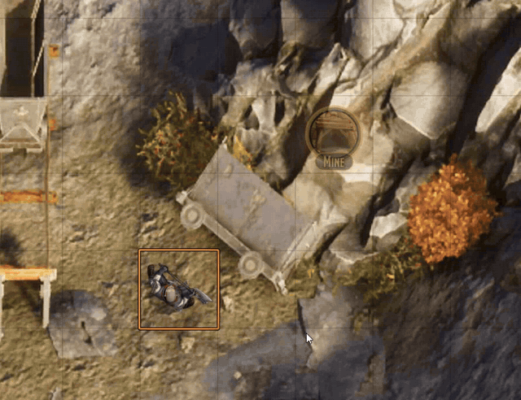
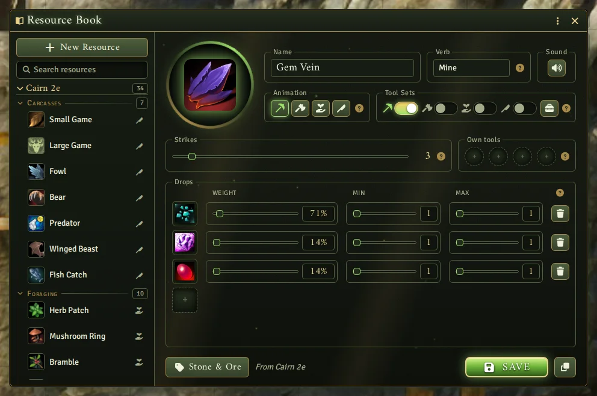
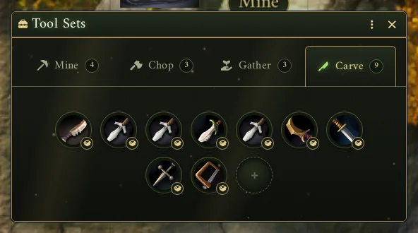
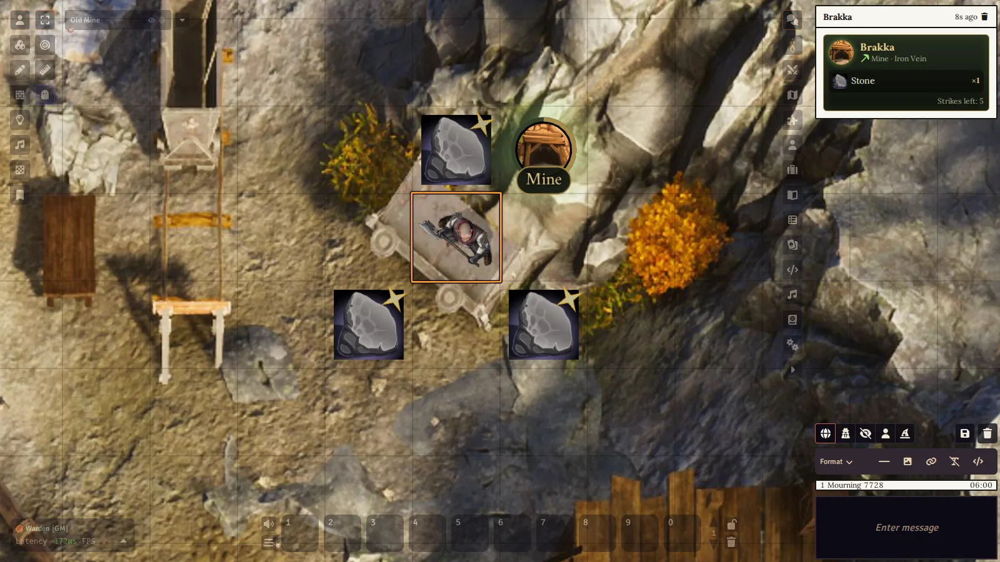
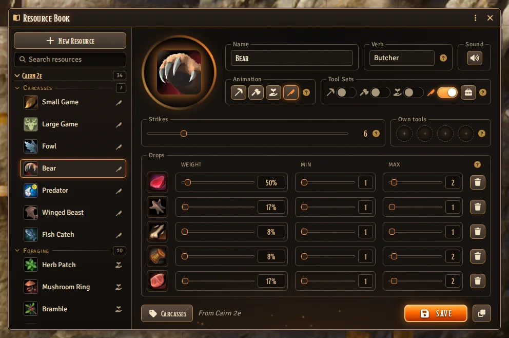

# Canvas Harvest

The party finds an iron vein in the mine wall. A player walks a token up to it and clicks the button
that appears over the vein. The pick swings three times, sparks fly, and the ore drops onto the floor
beside the vein as items anyone at the table can see and pick up.

Canvas Harvest lets the GM turn places on the map into things to mine, chop, gather or carve: an ore
vein, a tree, a herb bush, a deer brought down on the road. The GM describes each resource once
(what it gives, which tool it needs, how many strikes it holds) and drags it onto the map. What the
players harvest lands as [Canvas Loot](https://github.com/brunocalado/canvas-loot) items. Loot
becomes something the players go and get on the map, instead of a dice roll whose result someone
drags onto a character sheet.



[](https://buymeacoffee.com/mestredigital) [](https://mestredigital.online/pages/projetos-en)

## What a resource is

A resource is an entry in the GM's Resource Book. It has:

- a name, an image (a picture or a looping webm video), and the word on its button (Mine, Chop, Gather, Carve, or anything you type);
- the tools that work it: switch on any of the four Tool Sets (Mine, Chop, Gather, Carve), and add
  up to four tools of its own. Any item from a set that is switched on, or any of its own tools, is
  enough. With neither, bare hands will do;
- what it gives, up to five items, each with a weight and how many it gives. Every item starts
  level with the others; slide one down to make it rarer. The book shows each item's chance as a
  percentage;
- how many strikes a spot holds before it runs dry;
- one of four animations: strike (a pick on stone), chop (an axe on wood), gather (hands in a
  bush) and carve (a knife on a carcass).

Each strike gives one of those items, picked by its chance, in an amount between its min and max.

The animation only changes how a strike looks and sounds. Canvas Harvest doesn't need to know
whether a resource is a tree, a vein or a carcass, so any of them can use any animation, and the
module works in any system Canvas Loot works in.

A module or system can bring resources of its own. They are listed in the book under its name, and
you can change them like your own. The spots already on the map follow your change, and **Restore**
brings back the version the module provides.

The book lists resources by where they come from, and within that by animation: Mine, Chop, Gather
and Carve. The tag button at the bottom gives a resource a category of your own instead, such as
"Swamp" or "Deep Mines". Pick it again to put the resource back under its animation.



## Setting up spots

1. Fill the Tool Sets once: open **Tool Sets** from the module's settings, or with the toolbox
   button in the Resource Book, and drop the pickaxes, axes, sickles and knives of your world into
   the tabs. Each tab takes as many items as you like.

   

2. Open the Items directory and click **Resources**. The Resource Book also opens from the module's
   settings.
3. Click **New Resource**. Switch on the Tool Sets it takes (a set with no items can't be switched
   on). Drop any tools of its own and the items it gives from the Items directory, a compendium or a
   character sheet onto the slots, set the sliders, and click **Save**. An item from a sheet is
   replaced by the world or compendium item it came from; one made on the sheet itself is refused.
4. Drag the resource from the book's list onto the map. A spot appears there: a Region with the
   **Harvest Spot** behavior, full.
5. To make a carcass, drag the resource onto the creature's token instead. The spot is attached to
   the token and moves with it, and deleting the token deletes the spot.

Any Region can become a spot by hand, too: add the **Harvest Spot** behavior and pick the resource.

A spot keeps its own count of strikes. When it runs dry it stays on the map, grey, with a cracked
ring. Click it to refill it. Shift-click a spot that is not dry yet to fill it up again.

Forgot what a spot is? Right-click it to open its resource in the Resource Book.

## Harvesting

1. Select your token and walk it into the spot. When it arrives, the button with the resource's
   picture appears over the spot.
2. Click the button. The GM's client checks that the token is yours, stands in the spot, carries one
   of the tools and that the spot has strikes left, then spends one strike.
3. The strike plays on every screen: the button swings, your token leans in, and on each of the three
   blows sparks, splinters, leaves or scraps fly, with a sound for each blow.
4. The items pop out of the spot and land on free spaces around your token, never on another item
   or token. Pick them up with Canvas Loot. With no free space around you, the strike is refused and
   not spent: make room and strike again. A strike whose items could not be put on the map at all is
   not spent either.

A player who clicks without a tool is told which tools would do, and the GM whispers them a card
with every one of them, the items of each Tool Set included.



A card in the chat says who harvested what and how many strikes are left. Players only see the
button of the spot their token stands in. The GM sees every spot on the scene, dimmed until one of
their tokens stands in it, and a red warning on a spot whose resource was deleted.

## Settings

The theme setting picks Wilds (moss, bark and amber light) or Forge (soot, iron and embers). It
changes the windows, the chat card and the buttons on the map, for the whole table.



The GM sets the volume of the harvest sounds and the file each one plays in the **Harvest Sounds**
window, opened from the module's settings. The sounds play on the Environment channel, so each
player's own Environment volume applies. A resource can have a sound of its own, chosen with the
speaker button beside its animations in the Resource Book.

To keep the tools a secret, turn off **Whisper the Tools Needed**: the player then gets only the
short warning.

Under Foundry's photosensitive mode the shaking and the token's lunge are left out, and there are
fewer particles.

## For developers

Modules and systems can register their own resources, and macros can place, refill and strike spots.
A system can add its own rules around a strike: refuse it for a reason of its own (a vein that can
only be mined by day), or follow it with a consequence (a chat card asking for a save). It can also
react when a spot is made, runs dry or is refilled, to play a sound or post a message.

To know which resources its rules apply to, a system gives them tags. Tags are set through the API,
and they stay on a resource the GM edits or duplicates in the Resource Book. The API, the hooks, the tags
and the resource format are in [docs/API.md](docs/API.md).

## Installation

Requires [Canvas Loot](https://github.com/brunocalado/canvas-loot) 0.2.0 or later.
Install it from the Foundry VTT module browser, or use this manifest link:

```
https://github.com/brunocalado/canvas-harvest/releases/latest/download/module.json
```

[Grid Crafter](https://github.com/brunocalado/grid-crafter) is recommended: what players harvest
becomes what they craft.

## License

- GNU General Public License version 3. See `LICENSE`.
- Sounds made from Kenney's Impact Sounds and RPG Audio packs (CC0), https://kenney.nl. See
  `assets/sfx/CREDITS.md`.
